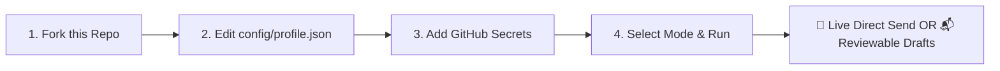
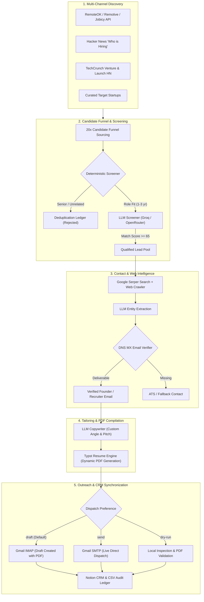

<div align="center">

# 🤖 Autonomous AI Outreach & Job Application Engine

**An open-source, multi-agent AI system that discovers hidden tech openings, screens for fit, enriches verified founder/recruiter emails, compiles tailored Typst PDF resumes, and either sends live emails autonomously or stages reviewable Gmail drafts—all running 100% on free-tier APIs.**

[](https://www.python.org/downloads/)
[](#-100-free-tier-stack)
[](#-dual-dispatch-modes-autopilot-or-draft-review)
[](https://typst.app/)
[](https://developers.notion.com/)

[⚡ Fork & Run in 3 Min](#-fork--run-in-3-minutes-zero-coding-required) • [Dual Dispatch Modes](#-dual-dispatch-modes-autopilot-or-draft-review) • [Quickstart](#-local-quickstart-2-minutes) • [Email Template](#-high-converting-cold-email-template) • [Architecture](#-architecture) • [Free Tier Stack](#-100-free-tier-stack)

</div>

---

## ⚡ Fork & Run in 3 Minutes (Zero Coding Required)

You don't even need to clone this repository to your machine. You can run the entire pipeline directly on GitHub Actions:



### 1. Click [Fork](https://github.com/abhishek09827/ihateapplying/fork)
Fork this repository to your personal GitHub account.

### 2. Update Your Profile (`config/profile.json`)
- In your forked repository, navigate to [`config/profile.json`](file:///home/abhishek/projects/ai-outreach-engine-oss/config/profile.json).
- Press the `.` (dot) key on your keyboard to open the GitHub Web Editor.
- Fill in your name, target roles, tech stack, and links (Google Drive resume, LinkedIn, GitHub, Portfolio).
- Commit your changes.

### 3. Add Free API Secrets
Go to **Settings > Secrets and variables > Actions > New repository secret** and add:
- `GROQ_API_KEY`: Get a free key at [console.groq.com](https://console.groq.com/keys) (14,400 free requests/day)
- `GMAIL_SENDER`: Your Gmail address (e.g. `yourname@gmail.com`)
- `GMAIL_APP_PASSWORD`: 16-character Google App Password from [myaccount.google.com/apppasswords](https://myaccount.google.com/apppasswords)
- *(Optional)* `SERPER_API_KEY`: Free key from [serper.dev](https://serper.dev) for Google web search email discovery
- *(Optional)* `NOTION_API_KEY` & `NOTION_DATABASE_ID`: For Notion CRM tracking

### 4. Trigger Outreach!
- Navigate to the **Actions** tab in your repository.
- Select **Autonomous AI Outreach Engine** from the left sidebar.
- Click **Run workflow**!
- Choose your preferred dispatch mode:
  - 🚀 **`send` (Direct Live Send via Gmail SMTP)**: Dispatches personalized emails directly on autopilot with tailored PDF resumes attached.
  - 📬 **`draft` (Create Reviewable Gmail Drafts)**: Stages drafts in your Gmail for 1-click human review.
  - 🔍 **`dry-run`**: Tests candidate screening and resume compilation with zero external actions.

---

## 🚀 Dual Dispatch Modes: Autopilot or Draft Review

The engine supports two distinct execution modes depending on your comfort level:

1. **🔥 Direct Send Autopilot (`DISPATCH_MODE=send`)**:
   - Sends emails directly to verified hiring managers and founders via Gmail SMTP.
   - Attaches the dynamic 1-page Typst PDF resume tailored to the target company.
   - Built-in anti-spam throttling (15s safe pacing between live emails) to protect your domain reputation.
   - Updates Notion CRM status to `"Email Sent Live"` in real time.

2. **🛡 Draft-First Safety Mode (`DISPATCH_MODE=draft`)**:
   - Stages fully rendered drafts in your Gmail Drafts folder with the tailored PDF resume attached.
   - Lets you inspect the pitch, tweak any words if desired, and click **Send** yourself.
   - Ideal for users who want 100% human-in-the-loop oversight.

---

## 🥊 Applying Manually vs. AI Outreach Engine

| Feature | Manual Outreach | Typical Job Bots | 🤖 AI Outreach Engine |
| :--- | :--- | :--- | :--- |
| **Outreach Options** | Manual typing | Blind spam (bans your domain) | **Dual Modes: Autonomous Live Send via SMTP OR 1-Click Gmail Drafts** |
| **Time per Application** | 20–30 minutes | Instant | **Autonomous (< 3 seconds)** |
| **Resume Quality** | Manual editing | Generic PDF dump | **Dynamic Typst PDF tailored to company tech stack** |
| **Email Quality** | High, but burns you out | Generic AI spam (ignored) | **75–95 word punchy emails with concrete proof of work** |
| **Deliverability** | High | Low (bounces) | **Public DNS MX Verification before every send** |
| **Monthly Cost** | Free (costs your sanity) | $50–$150/month | **$0.00/month (100% Free Tier APIs)** |
| **Application Tracking** | Messy spreadsheet | None | **Live bidirectional Notion CRM + CSV ledger** |

---

## 📨 High-Converting Cold Email Template

Founders and engineering leads delete generic cover letters. This engine generates crisp, **75–95 word peer-to-peer emails** that cite real engineering achievements and automatically append your portfolio, GitHub, LinkedIn, and master Google Drive resume:

```text
Subject: Software Engineering @ Portkey — Alex Mercer

Hi Rohit,

I’ve been following Portkey’s recent work scaling enterprise LLM gateways and low-latency semantic caching.

At my previous role, I engineered event-driven ingestion pipelines handling 40K records/sec using Python, FastAPI, and Kafka, and optimized semantic search indexing to cut query latency by 45%. Given your team’s expansion into automated agent routing, I’d love to contribute to your core backend and reliability layer.

Are you open to a brief 10-minute chat this week? If you prefer, I can also submit directly via your careers portal.

Best regards,
Alex Mercer
Software & AI Engineer
+1 (555) 019-2834 | alex.mercer@example.com

Verified Links:
• Master Resume (Google Drive): https://drive.google.com/file/d/YOUR_RESUME_ID/view
• Portfolio: https://your-portfolio.dev
• GitHub: https://github.com/your-username
• LinkedIn: https://linkedin.com/in/your-profile

📎 Tailored 1-page PDF resume is also attached for your convenience.
```

---

## 🏛 Multi-Agent Architecture



---

## 💸 100% Free Tier Stack

| Service | Free Tier Allowance | Purpose in Engine |
| :--- | :--- | :--- |
| **[Groq Console](https://console.groq.com)** | **14,400 requests/day** (`openai/gpt-oss-120b`) | Rapid candidate screening & cold email drafting (~0.8s) |
| **[OpenRouter](https://openrouter.ai)** | Unlimited free-tier models (`llama-3.3-70b-instruct:free`) | Automated LLM fallback failover |
| **[Serper.dev](https://serper.dev)** | **2,500 free Google searches** | Discovering founder and recruiter email addresses |
| **[Gmail](https://myaccount.google.com/apppasswords)** | Free via App Passwords | Creating Gmail drafts and sending SMTP outreach |
| **[Notion API](https://developers.notion.com)** | Free tier | Real-time application tracking CRM |
| **[GitHub Actions](https://github.com/features/actions)** | **2,000 runner minutes/month** | Scheduled autonomous execution twice daily |

---

## 💻 Local Quickstart (2 Minutes)

If you prefer running locally on your own machine:

### 1. Clone & Install
```bash
git clone https://github.com/abhishek09827/ihateapplying.git
cd ihateapplying

# Create virtual environment
python3 -m venv venv
source venv/bin/activate  # On Windows: venv\Scripts\activate

# Install dependencies
pip install -r requirements.txt
```

### 2. Interactive Setup Wizard
Run the interactive wizard to verify your free API credentials live:
```bash
python setup.py
```

### 3. Run Outreach
```bash
# 🚀 Option A: Full Autopilot (Directly sends personalized emails via Gmail SMTP)
python run_agent.py --target 5 --dispatch-mode send --dispatch

# 📬 Option B: Draft Review (Stages drafts in your Gmail for 1-click human review)
python run_agent.py --target 5 --dispatch-mode draft --dispatch

# 🔍 Option C: Safe Dry Run (Screens, enriches, and compiles resumes without emailing)
python run_agent.py --dry-run

# 🩺 Check service health & diagnostics
python run_agent.py --status
```

---

## 🗃 Notion CRM Setup

Create a database in Notion and share it with your Notion Integration Token. Add the following columns:

| Column Name | Property Type | Description |
| :--- | :--- | :--- |
| **`Company`** | `Title` | Company name |
| **`Role / Pitch Angle`** | `Rich Text` | Role name and tailored pitch angle |
| **`Channel`** | `Select` | Source (`RemoteOK`, `HackerNews`, `TechCrunch`, etc.) |
| **`Match Score`** | `Number` | Fit score out of 100 |
| **`Target Contact`** | `Rich Text` | Name and title of founder/recruiter |
| **`Contact Email`** | `Email` | Verified recipient email |
| **`Dispatch Status`** | `Select` | Options: `Draft Created in Gmail`, `Email Sent Live`, `To Review` |
| **`Custom Cold Email`** | `Rich Text` | Cold email copy generated by LLM |
| **`Job Posting URL`** | `URL` | Link to job posting or company website |
| **`LinkedIn URL`** | `URL` | Recruiter or founder LinkedIn profile |

> **Tip:** You can paste your Notion database URL directly into `setup.py`—the engine automatically normalizes database IDs into valid UUIDs.

---

## 📬 Dispatching Pending Applications from Notion

If you manually add companies to your Notion database or update emails, run the standalone dispatcher:

```bash
# Create Gmail drafts for all pending rows in Notion
python dispatch_pending.py

# Automatically use AI web search to find missing emails before creating drafts
python dispatch_pending.py --enrich-missing

# Live send via SMTP
python dispatch_pending.py --send
```

---

## 🐳 Docker Deployment

```bash
# Build and run with default dry-run
docker compose up --build

# Run custom target inside container
docker compose run outreach-engine python run_agent.py --target 5
```

---

## 🧪 Running Unit Tests

The test suite runs with standard library `unittest` (zero external test dependencies):

```bash
python3 -m unittest discover tests
```

---

## 🤝 Contributing & Community

Contributions, issues, and feature requests are welcome!
Feel free to check the [issues page](https://github.com/abhishek09827/ihateapplying/issues) or submit a pull request.

If this project helps you in your job search or saves you hours of manual applications, please give it a ⭐ on GitHub!

---
