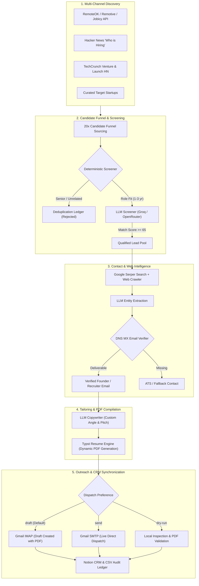

<div align="center">

# 🤖 Autonomous AI Outreach & Job Application Engine

**An open-source, multi-agent AI system that discovers hidden tech openings, screens for fit, enriches verified founder/recruiter emails, compiles tailored Typst PDF resumes, and prepares personalized Gmail drafts—all running 100% on free-tier APIs.**

[](https://opensource.org/licenses/MIT)
[](https://www.python.org/downloads/)
[](#-100-free-tier-stack)
[](https://typst.app/)
[](https://developers.notion.com/)

[Quickstart](#-60-second-quickstart) • [Architecture](#-architecture) • [Features](#-key-features) • [Free Tier Stack](#-100-free-tier-stack) • [Notion CRM Setup](#-notion-crm-setup) • [GitHub Actions](#-1-click-github-actions-automation)

</div>

---

## 💡 Why AI Outreach Engine?

Submitting generic resumes into ATS black holes rarely yields results. The most effective job search strategy is **highly personalized, direct outreach to engineering leads, hiring managers, and founders with tailored resumes**.

However, doing this manually takes 20–30 minutes per company. **AI Outreach Engine automates this entire pipeline autonomously**:

1. **Scouts** fresh opportunities across RemoteOK, Remotive, Jobicy, Hacker News *Who is Hiring*, TechCrunch Venture feeds, and Launch HN.
2. **Screens** postings in milliseconds against your target roles and experience bracket (filtering out unrealistic 7+ year senior positions).
3. **Enriches** leads with verified executive contacts and emails using Google Search intelligence and public DNS MX validation.
4. **Compiles** a unique, ATS-optimized PDF resume for each company using the ultra-fast [Typst](https://typst.app) markup compiler.
5. **Stages** drafts in your Gmail account with the tailored PDF resume attached and direct links to your portfolio, GitHub, LinkedIn, and master drive resume—ready for your 1-click review and send.
6. **Logs** every application and status in a real-time Notion CRM.

---

## 🏛 Architecture



---

## ✨ Key Features

- **🛡 "Draft-First" Safety Guarantee**: By default (`DISPATCH_MODE=draft`), the engine stages polished drafts in your Gmail drafts folder. You retain complete human oversight before any email leaves your inbox.
- **📄 Native Typst PDF Compilation**: Compiles hyper-targeted, beautifully typeset PDF resumes in sub-second time without slow LaTeX installations.
- **🎯 1-3 Year Seniority & Role Guard**: Deterministic regex filter automatically discards Staff, Principal, and Director postings, ensuring 100% of outreach matches your real target level.
- **🔍 Intelligent Lead Enrichment**: Uses Google Serper API + direct domain crawling + LLM parsing to find hiring managers and founders, backed by DNS MX deliverability checks to prevent bounces.
- **📊 Bidirectional Notion CRM**: Automatically syncs status, contact email, pitch angles, and job links to your Notion workspace. Run `python dispatch_pending.py` anytime to process or re-dispatch pending rows.
- **⚡ 100% Free Tier Compatible**: Designed specifically to run at **$0/month** total operating cost.

---

## 💸 100% Free Tier Stack

| Service | Free Tier Allowance | Purpose in Engine |
| :--- | :--- | :--- |
| **[Groq Console](https://console.groq.com)** | **14,400 requests/day** (`openai/gpt-oss-120b`) | Rapid candidate screening & cold email drafting (~0.8s) |
| **[OpenRouter](https://openrouter.ai)** | Unlimited free-tier models (`llama-3.3-70b-instruct:free`) | Automated LLM fallback failover |
| **[Serper.dev](https://serper.dev)** | **2,500 free Google searches** | Discovering founder and recruiter email addresses |
| **[Gmail](https://myaccount.google.com/apppasswords)** | Free via App Passwords | Creating Gmail drafts and sending SMTP outreach |
| **[Notion API](https://developers.notion.com)** | Free tier | Real-time application tracking CRM |
| **[GitHub Actions](https://github.com/features/actions)** | **2,000 runner minutes/month** | Scheduled autonomous execution twice daily |

---

## 🚀 60-Second Quickstart

### Step 1: Clone and Install Dependencies

```bash
git clone https://github.com/your-username/ai-outreach-engine.git
cd ai-outreach-engine

# Create virtual environment
python3 -m venv venv
source venv/bin/activate  # On Windows: venv\Scripts\activate

# Install dependencies
pip install -r requirements.txt
```

### Step 2: Run the Interactive Setup Wizard

The built-in setup wizard will test your credentials live and create your `.env` and `config/profile.json` in under 2 minutes:

```bash
python setup.py
```

```
   ___    ____   ____         __                       __       ______            _          
  /   |  /  _/  / __ \__  __/ /_________  ____ ______/ /_     / ____/___  ____ _(_)___  ___ 
 / /| |  / /   / / / / / / / __/ ___/ _ \/ __ `/ ___/ __ \   / __/ / __ \/ __ `/ / __ \/ _ \
/ ___ |_/ /   / /_/ / /_/ / /_/ /  /  __/ /_/ / /__/ / / /  / /___/ / / / /_/ / / / / /  __/
/_/  |_/___/   \____/\__,_/\__/_/   \___/\__,_/\___/_/ /_/  /_____/_/ /_/\__, /_/_/ /_/\___/ 
                                                                        /____/               
Autonomous AI Job Search & Outreach Engine (100% Free-Tier Compatible)
```

### Step 3: Run Outreach!

```bash
# 1. Safe Dry Run (Screen, enrich, and compile resumes without touching Gmail)
python run_agent.py --dry-run

# 2. Stage drafts in Gmail (Default safe mode)
python run_agent.py --target 5

# 3. Check service health & diagnostics
python run_agent.py --status
```

---

## 📋 CLI Usage & Options

`run_agent.py` supports modular execution flags:

```bash
python run_agent.py [OPTIONS]

Options:
  --target INTEGER       Target number of qualified leads (default: 6)
  --mode [all|remote-jobs|funded-startups]
                         Sourcing channel (default: all)
  --max-scans INTEGER    Safety cap on total leads evaluated (default: 50)
  --dispatch-mode [draft|send|dry-run]
                         Override dispatch behavior
  --dispatch             Execute live dispatch according to .env DISPATCH_MODE
  --dry-run              Simulate execution with zero external modifications
  --status               Print service diagnostics table
  --setup                Re-launch interactive setup wizard
```

### Dispatching Pending Applications from Notion

If you manually add companies to your Notion database or update emails, run the standalone dispatcher to process them:

```bash
# Create Gmail drafts for all pending rows in Notion
python dispatch_pending.py

# Automatically use AI web search to find missing emails before creating drafts
python dispatch_pending.py --enrich-missing

# Live send via SMTP
python dispatch_pending.py --send
```

---

## 🗃 Notion CRM Setup

Create a database in Notion and share it with your Notion Integration Token. Add the following columns:

| Column Name | Property Type | Description |
| :--- | :--- | :--- |
| **`Company`** | `Title` | Company name |
| **`Role / Pitch Angle`** | `Rich Text` | Role name and tailored pitch angle |
| **`Channel`** | `Select` | Source (`RemoteOK`, `HackerNews`, `TechCrunch`, etc.) |
| **`Match Score`** | `Number` | Fit score out of 100 |
| **`Target Contact`** | `Rich Text` | Name and title of founder/recruiter |
| **`Contact Email`** | `Email` | Verified recipient email |
| **`Dispatch Status`** | `Select` | Options: `Draft Created in Gmail`, `Email Sent Live`, `To Review` |
| **`Custom Cold Email`** | `Rich Text` | Cold email copy generated by LLM |
| **`Job Posting URL`** | `URL` | Link to job posting or company website |
| **`LinkedIn URL`** | `URL` | Recruiter or founder LinkedIn profile |

> **Tip:** You can paste your Notion database URL directly into `setup.py`—the engine automatically normalizes database IDs into valid UUIDs.

---

## ☁️ 1-Click GitHub Actions Automation

Run the engine 24/7 on GitHub Actions without hosting a server:

1. Fork this repository.
2. In your fork, go to **Settings > Secrets and variables > Actions > New repository secret**.
3. Add the following repository secrets:
   - `GROQ_API_KEY`: Your free Groq key from [console.groq.com](https://console.groq.com)
   - `GMAIL_SENDER`: Your Gmail address
   - `GMAIL_APP_PASSWORD`: Your 16-character Google App Password
   - `NOTION_API_KEY`: (Optional) Your Notion internal integration secret
   - `NOTION_DATABASE_ID`: (Optional) Your Notion database ID
   - `SERPER_API_KEY`: (Optional) Your free Serper key from [serper.dev](https://serper.dev)
   - `CANDIDATE_PROFILE_JSON`: (Optional) Entire JSON contents of your `config/profile.json`
4. The workflow runs on a twice-daily schedule (Monday–Friday) or can be triggered manually via the **Actions** tab with the **Run workflow** button.
5. All tailored PDF resumes are preserved as downloadable GitHub artifacts for 14 days!

---

## 🐳 Docker Deployment

Run with Docker and Docker Compose:

```bash
# Build and run with default dry-run
docker compose up --build

# Run custom command inside container
docker compose run outreach-engine python run_agent.py --target 5
```

---

## 🧪 Running Unit Tests

The test suite uses Python's standard `unittest` framework with zero external test dependencies:

```bash
python3 -m unittest discover tests
```

---

## 🤝 Contributing

Contributions are welcome! Please feel free to submit a Pull Request.
1. Fork the Project
2. Create your Feature Branch (`git checkout -b feature/NewFeature`)
3. Commit your Changes (`git commit -m 'feat: Add NewFeature'`)
4. Push to the Branch (`git push origin feature/NewFeature`)
5. Open a Pull Request

---

## ⚖️ License

Distributed under the MIT License. See [`LICENSE`](file:///home/abhishek/projects/ai-outreach-engine-oss/LICENSE) for more information.

---

<div align="center">
Built for engineers, job seekers, and founders seeking intelligent, ethical, and high-impact outreach.
</div>
